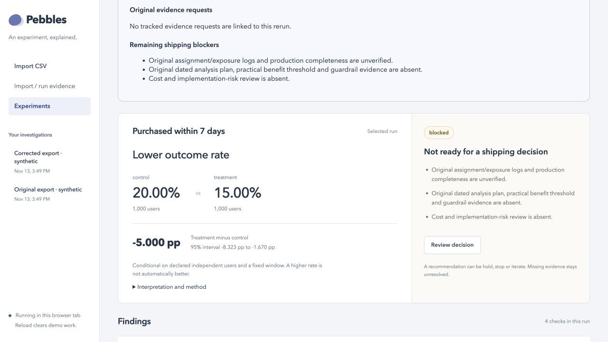
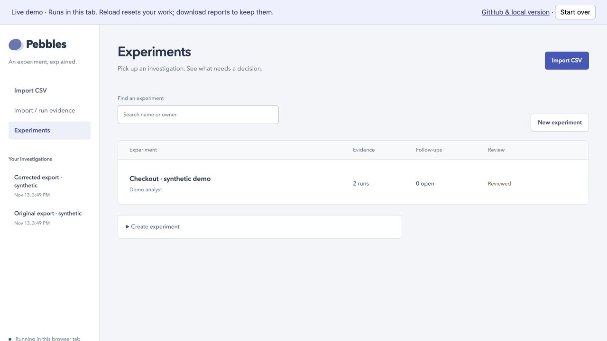
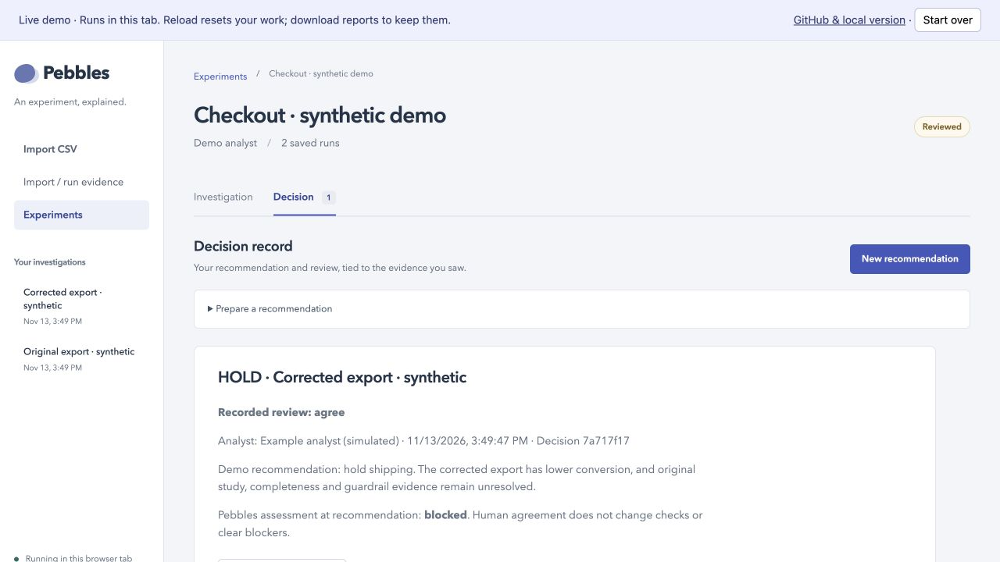

# Pebbles

**Understand an A/B test result—and what still needs checking before you ship.**

Pebbles brings the result, missing evidence, corrections and decision into one workspace. It is built for analysts investigating experiments; product managers can follow the reasoning and see why a change is ready—or not ready—for a decision.

## Start here: try it in your browser

### [Open the live demo →](https://farmanp.github.io/pebbles/)

**No installation, account, API key or dataset needed.** A checkout experiment is already loaded. The first visit may take a little longer while the analysis engine loads.

**Your task:** decide whether the team should ship the checkout change.

1. Read **What changed in this rerun?** The original export appeared to show better conversion. Restoring 500 missing users reverses the result.
2. Use **Evidence run** to switch between **Original export · synthetic** and **Corrected export · synthetic**. Control stays at **20%**; treatment changes from **30% to 15%**. Read the remaining shipping blockers.
3. Open **Decision**. Read the example **HOLD** recommendation and simulated review. Choose **Download decision and evidence ZIP** to take the reasoning and source evidence with you.

**What you should take away:** a positive-looking dashboard result can change when the evidence changes. Pebbles shows the difference and keeps unanswered questions visible; it does not automatically approve a launch.

> The demo is synthetic, including its recommendation and reviewer. Work stays in this browser tab and is cleared when you reload or close it. Download anything you want to keep. For a workspace you can return to later, [run locally](#run-locally).

[](docs/images/investigation-desktop.jpg)

*Click any screenshot to open it at full size.*

## What am I looking at?

| In the app | In plain English |
| --- | --- |
| **Experiment** | The workspace for one product change you are evaluating. |
| **Evidence run** | One saved analysis of the files supplied at that point in time. A correction creates another run; it does not overwrite the original. |
| **Treatment / control** | The changed experience / the comparison experience. |
| **pp** | Percentage points: 30% versus 20% is a **10 percentage-point** difference. |
| **95% interval** | The uncertainty range around the estimated difference, under the stated assumptions. An interval crossing zero leaves the direction inconclusive. |
| **Supported** | That particular check is supported by the supplied evidence. It does **not** mean the treatment won or is safe to ship. |
| **Blocked / unresolved** | Evidence is missing or a check has not established what you need. Read the explanation and next evidence request. |
| **Reviewed** | Someone recorded a response to a recommendation. It is separate from the experiment result and does not clear blockers. |

## Try the investigation workflow

Stay with the included example to explore these actions without preparing any data:

| I want to… | Where to go |
| --- | --- |
| Understand why the result is uncertain | **Investigation → Interpretation and method**, or expand a finding. |
| Ask for missing evidence | Expand a finding → **Request evidence** → edit the suggested request → **Save evidence request**. This records a follow-up; it does not send a message. |
| Add evidence someone supplied | Open the follow-up → **Add received evidence**. Attach the file and describe what was received. |
| Rerun a corrected export | Save it as **Corrected outcome CSV — validate and rerun**, then choose **Validate and rerun this CSV**. Confirm the mapping and study details before running. |
| See whether the correction matters | Read **What changed in this rerun?** Compare the conclusion, shipping assessment and original request’s recheck. |
| Record my judgment | **Decision → New recommendation**. Choose Ship, Hold, Stop or Iterate, explain why, and acknowledge the unresolved evidence. |
| Share a reviewed decision | Record the reviewer’s response, then **Download decision and evidence ZIP**. The packet includes source data—check it before sharing. |

Corrected findings link back to the original request. New runs **or newly received files** flag older reviews for renewal. Plans and logs can be saved for manual review; uploading them does not automatically verify their claims.

**Find your experiments**

[](docs/images/experiments-desktop.jpg)

**Record the decision**

[](docs/images/decision-desktop.jpg)

Screenshots show the synthetic demo. They are not evidence of a real customer investigation or analyst study.

## Bring your own experiment

Start with **Experiments → New experiment**, give it a name, then choose **Import CSV into this experiment**. This keeps the import and later corrections together.

You need a CSV with **one row per user**, two groups, and a yes/no outcome. Column names can differ; you map them in the app. For example:

```csv
user_id,group,purchased
u1,control,1
u2,control,0
u3,treatment,1
u4,treatment,0
```

*This tiny example illustrates the file format, not enough evidence for a shipping decision.*

1. Upload the file and select the user, group and outcome columns.
2. Identify which group is control and which is treatment. Explain what `1` means, who is included and the observation period.
3. Confirm the supported study design, then **Validate mapping and preview**.
4. Review any errors. If validation passes, choose **Run CSV investigation**.

**Supported:** completed tests with independent users, a fixed observation period and a binary outcome (`0/1` or `true/false`). Main CSV intake accepts up to **100,000 rows / 20 MB**. Received files attached to a request have a separate limit of **1 MB each / 10 files per request**, in UTF-8 CSV, JSON, TXT, MD or SQL format.

**A CSV alone cannot establish trustworthy assignment, complete event capture, acceptable business risk or all required guardrails.** Bring your analyst into those checks. Pebbles does not run experiments, connect to your warehouse, or deploy product changes. Continuous metrics, clustered designs and sequential stopping are outside guided CSV intake. [Read the statistical scope and method](STATISTICAL_METHOD.md).

## Keep your work and data

- **Live demo:** files are processed in your tab, not uploaded to an analysis server. There is no account or shared workspace. Reloading clears the session.
- **Local app:** evidence and decisions persist on your computer. The quick start below stores them in `runs/quickstart/`.
- **Sharing:** individual reports are available from **Open full report**. The decision/evidence ZIP becomes available after a reviewer response is recorded. There is no built-in reviewer invitation or messaging service.
- **Review identities:** analyst and reviewer names are local labels, not authenticated approvals. Recording “Ship” does not deploy anything.

## Run locally

Use this option if you want to close Pebbles and return to the same workspace later. You need **Git and Python 3.11+** installed; a teammate can help with this one-time setup.

```sh
git clone https://github.com/farmanp/pebbles.git
cd pebbles
python3 start.py
```

Your browser opens the populated checkout demo. No additional packages, API keys or frontend build are required. To return later, run `python3 start.py` from the same folder. Stop the server with **Ctrl+C**.

<details>
<summary>Local startup, storage and troubleshooting</summary>

- If the browser does not open, use `python3 start.py --no-browser` and open the printed URL.
- The default port is 8848; the launcher chooses another available local port if needed.
- To choose a storage location: `python3 start.py --storage /path/to/folder`.
- Back up the whole storage folder, including its database and saved runs. These files are excluded from Git.
- The lower-level `python3 -m pebbles.web` command uses `runs/ui/` by default; this is separate from the quick-start workspace.
- If optional fixture downloads fail on macOS with `CERTIFICATE_VERIFY_FAILED`, configure your Python installation’s CA certificates. Do not disable TLS verification.

</details>

## For analysts and contributors

- [Statistical method and limitations](STATISTICAL_METHOD.md)
- [Problem tree](OPPORTUNITY_TREE.md) · [Roadmap](docs/analyst-workflow-roadmap.md)
- [Guided CSV intake](docs/guided-data-intake.md) · [Received evidence and reruns](docs/request-received-evidence.md) · [Reviewed decisions and handoff](docs/reviewed-decisions.md)
- [Contributing](CONTRIBUTING.md) · [Reporting a security issue](SECURITY.md)

<details>
<summary>Development setup and optional Cookie Cats fixtures</summary>

```sh
python3 scripts/setup_fixtures.py --with-public-data
python3 -m unittest discover -s tests -v
# Node.js 22 is needed for development checks, not to run Pebbles.
for file in pebbles/static/*.js webdemo/*.js; do node --check "$file"; done
for file in tests/js/*.cjs; do node "$file"; done
```

Omit `--with-public-data` for synthetic fixtures only. Cookie Cats downloads are pinned by hash; see [third-party notices](THIRD_PARTY_NOTICES.md). Unavailable example packets are hidden until generated.

The Python engine and local server live in `pebbles/`; the UI is in `pebbles/static/`. Tests are in `tests/`, fixture generators in `examples/` and `evaluation/`, and design records in `docs/` and `planning/`. Historical documents may reference local artifacts intentionally omitted from Git.

Use branches and pull requests. Protected `main` requires passing CI on Python 3.11 and 3.13. Do not commit private experiment exports, local databases or facilitator answer keys intended to stay hidden from participants.

</details>

## License

Proprietary; no open-source license has been granted. See [LICENSE](LICENSE) and [third-party notices](THIRD_PARTY_NOTICES.md).
