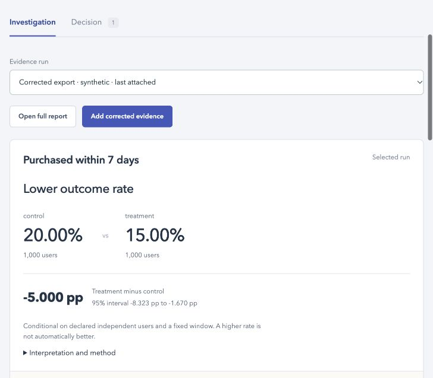
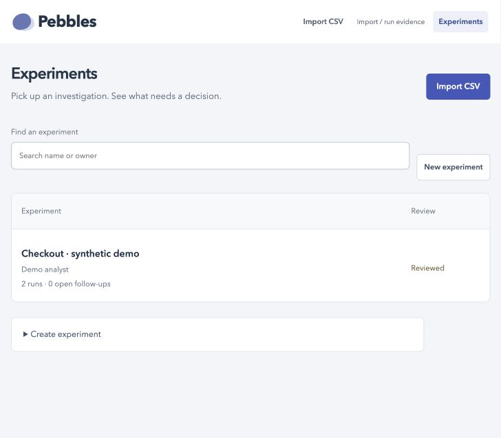
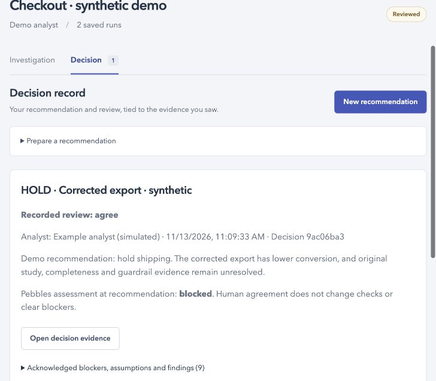

# Pebbles

**Can you trust this A/B test enough to ship?** Inspect the result, investigate missing evidence and share a reviewed decision.

## Try the live demo

### [Open Pebbles →](https://farmanp.github.io/pebbles/)

**No install, account or API key.** Opens a populated synthetic checkout investigation. The same Python analysis engine runs in your browser; selected files are processed in your tab, not uploaded to an analysis server. The first visit downloads the browser runtime and may take a little longer.

**Temporary workspace:** reloading or closing the tab clears your demo work. Download reports or the decision/evidence ZIP to keep results. Use the local version below for a workspace that persists between visits.



### Your first three clicks

1. **Evidence run → Original export**: see an apparent conversion increase.
2. **Evidence run → Corrected export**: see the result reverse after 500 omitted users are restored. Expand **Revision comparisons** to inspect what changed. Shipping remains blocked.
3. **Decision**: read the clearly labeled simulated recommendation/review, then **Download decision and evidence ZIP**.

Click **Import / run evidence** to calculate a new synthetic example, or **Import CSV** to map your own user, variant and binary outcome columns. Cookie Cats fixtures are available in the local version.

## Run locally

With **Git and Python 3.11+ already installed**, clone and run:

```sh
git clone https://github.com/farmanp/pebbles.git
cd pebbles
python3 start.py
```

Your browser opens the same synthetic checkout investigation. No pip install, API key, data download or frontend build. The local demo is saved separately under `runs/quickstart/`; relaunching preserves it. Stop with **Ctrl+C**. For a terminal-only environment: `python3 start.py --no-browser` and open the printed URL. If port 8848 is busy, an available loopback port is chosen automatically.

## See the workspace

| Experiments | Decision |
| --- | --- |
|  |  |

These are screenshots of the included synthetic checkout demo. The recommendations and reviews are simulated, not a real customer investigation or human analyst study.

<details>
<summary>Optional: synthetic examples and Cookie Cats comparison fixtures</summary>

```sh
python3 scripts/setup_fixtures.py --with-public-data
python3 -m pebbles.web --port 8848
```

Omit `--with-public-data` for synthetic fixtures only. Cookie Cats downloads are pinned by hash; see [third-party notices](THIRD_PARTY_NOTICES.md). Unavailable example packets are hidden until generated. On macOS, configure your Python installation's CA certificates if downloads report a certificate error; never disable TLS verification.

</details>

## Analyst workflow

- **Experiments:** create a workspace, attach saved runs and find unfinished work.
- **Investigation:** import an ordinary user-level binary CSV, map columns, validate rows, inspect effects and blockers, preview evidence and track requests. Prepared packages support deeper checks.
- **Evidence revisions:** preserve originals and compare populations, results, settings, findings and blockers after a correction.
- **Decision:** record ship/hold/stop/iterate, acknowledge unresolved evidence, record a reviewer response and download the evidence handoff. Additional runs flag older reviews for renewal.

Names are local labels, not authenticated identities. Workflow closure and reviewer agreement never change analytical outcomes. Missing evidence stays unresolved; a hold or inability to decide is a valid result.

## Data and scope

The hosted demo uses a separate temporary filesystem in each browser tab. No shared analysis backend or account storage is used.

The local server binds to loopback. Runs, evidence and the workspace database live under `runs/ui/`, excluded from Git. Override with `--storage /path/to/folder`; back up database and run directories together. Handoff ZIPs include source data—inspect before sharing.

Guided intake supports one row per user, two arms and one binary outcome under declared fixed-horizon independent-user assumptions. It does not establish upstream completeness. Binary guardrails and selected denominator, metric and population discrepancies are supported in documented package formats. Clustered/sequential designs, general SQL equivalence, continuous metrics, connectors and production rollout remain outside scope. Read the [statistical method](STATISTICAL_METHOD.md).

## Development

```sh
python3 scripts/setup_fixtures.py --with-public-data
python3 -m unittest discover -s tests -v
# Node.js 22 is for syntax checks; it is not required to run the app.
for file in pebbles/static/*.js webdemo/*.js; do node --check "$file"; done
```

CI tests Python 3.11 and 3.13 with read-only permissions and commit-pinned actions. Downloaded fixtures are hash-verified and never uploaded as CI artifacts. Use branches and pull requests; see [contributing](CONTRIBUTING.md) and [security](SECURITY.md).

## Project map

| Location | Purpose |
| --- | --- |
| `pebbles/` | Engine, local HTTP app, workspace and exports |
| `pebbles/static/` | Browser UI without a frontend build step |
| `tests/` | Engine, persistence, HTTP and presentation tests |
| `examples/`, `evaluation/` | Synthetic/controlled materials and generators |
| `public_comparisons/` | Comparison code and pinned provenance |
| `docs/`, `planning/` | Feature contracts, design, verification and limitations |

Start with the [problem tree](OPPORTUNITY_TREE.md) and [roadmap](docs/analyst-workflow-roadmap.md). Feature records: [workspace UX](docs/analyst-workspace-redesign.md), [guided intake](docs/guided-data-intake.md), [revisions](docs/evidence-revisions.md), [reviewed handoff](docs/reviewed-decisions.md).

Historical documents link to some local walkthrough artifacts and generated packets intentionally omitted from Git. Rebuild fixtures with the setup command. Private session evidence is not part of a clone. Facilitator answer keys must remain hidden from evaluation participants.

## License

Private, proprietary project; no open-source license has been granted. See [LICENSE](LICENSE) and [third-party notices](THIRD_PARTY_NOTICES.md).

On macOS, if Python reports `CERTIFICATE_VERIFY_FAILED` during fixture download, configure that Python installation's CA certificates (for python.org builds, run its bundled Install Certificates command) or use a properly configured Homebrew Python. Do not disable TLS verification.
